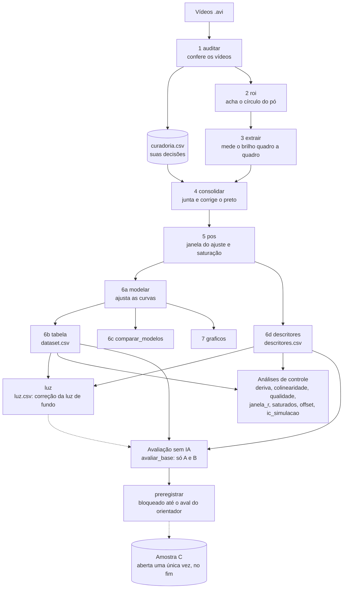

# Guia do projeto `luminescencia`: o que cada parte faz e por quê

Este guia é para quem nunca viu o projeto: o orientador, um colega, uma banca ou você daqui a seis meses. Não é preciso saber programar para entender as seções 1 a 3. As seções 4 e 5 descrevem cada parte do código. Detalhes técnicos e números estão no `README.md`; as decisões, com data, em `docs/DECISOES.md`.

Versão do código descrita: **0.19.0** (04/11/2026), com 295 testes automáticos.

---

## 1. O projeto em uma página

**A pergunta científica.** Um pó luminescente é uma mistura de três pós, que brilham em vermelho (R), verde (G) e azul (B). Depois de iluminado, o pó continua brilhando e vai apagando aos poucos (o **decaimento**). Cada componente apaga em um ritmo próprio. A ideia do projeto é **descobrir a composição da mistura (quanto há de R, G e B) só olhando um vídeo desse decaimento**.

**Como os dados são gerados.** Para cada uma das **16 composições**, o pó é preparado e filmado: uma luz acende (excitação), apaga em menos de meio segundo e a câmera grava o brilho que sobra. Cada composição foi preparada três vezes, em sessões diferentes (as **amostras A, B e C**), e cada preparação foi filmada até cinco vezes (as **regravações**). No total há **236 vídeos aceitos** (A 79, B 78, C 79).

**O que o código faz.** Ele transforma os vídeos em números confiáveis e comparáveis e prepara um teste honesto para a futura IA:

1. confere os vídeos e acha a amostra na imagem;
2. mede o brilho de cada cor, quadro a quadro;
3. corrige e limpa as medidas, sempre do mesmo jeito para todos os vídeos;
4. descreve cada curva de decaimento com números (por exemplo, o tempo característico τ, "tau");
5. monta uma tabela com uma linha por vídeo, pronta para treinar uma IA;
6. faz análises de controle (o que pode enganar a IA?) e prepara a avaliação, com a amostra C guardada "lacrada" para o teste final.

**O que o código ainda não faz, por decisão.** Não treina nenhuma IA e não tem aplicativo. Hoje ele entrega a base: dados limpos, regras de avaliação, linhas de base simples e as travas que impedem trapaça sem querer.

**A preocupação central.** Uma IA aprende qualquer padrão, inclusive os errados. Se os vídeos de uma sessão forem um pouco mais claros, ela pode aprender a "reconhecer a sessão" em vez da composição. Por isso quase todas as regras do projeto existem para garantir duas coisas:

- **todos os vídeos são medidos do mesmo jeito**;
- **a resposta nunca vaza para a entrada** (a IA não pode ver, direta ou indiretamente, a composição que deve adivinhar).

---

## 2. Glossário

| Termo | O que significa aqui |
|---|---|
| **Canal R, G, B** | As três cores que a câmera mede. Cada pó brilha mais em um canal. |
| **Excitação / decaimento** | Excitação: a luz está acesa. Decaimento: a luz apagou e só resta o brilho do pó, que vai caindo. O corte entre os dois é fixo em **0,5 s** para todos os vídeos. |
| **Proporção / composição** | Quanto de cada pó há na mistura, lido do nome do arquivo (ex.: `GB_1_05` = G 1, B 0,5). As quantidades somam sempre 1,5. |
| **Amostra A, B, C** | Três preparações da mesma composição, feitas e filmadas em sessões diferentes. |
| **Preparação** | Uma composição em uma amostra (ex.: `G1_B0.5` na amostra B). É a unidade real de repetição. |
| **Regravação** | Outro vídeo da **mesma** preparação. Mede o ruído da câmera, não a variação entre preparações. |
| **ROI** | "Região de interesse": o círculo da imagem onde está o pó. Só os pixels de dentro contam. |
| **Preto (piso)** | O nível que a câmera mostra mesmo sem luz. É descontado de cada vídeo para não confundir com brilho. |
| **Saturação** | Quando o brilho passa do máximo que a câmera registra. A medida deixa de ser confiável. Há **9 vídeos** que saturam tarde demais e ficam fora do ajuste principal. |
| **τ (tau)** | Tempo característico do decaimento: quanto menor, mais rápido o pó apaga. |
| **Exponencial simples / dupla** | Equações usadas para descrever a curva. A dupla (dois ritmos somados) é o modelo principal, porque a simples quase nunca se encaixa. |
| **C (patamar)** | Nível onde a curva "pararia" se o tempo fosse infinito. Há dois caminhos lado a lado: **c0** (C fixo em 0) e **cl** (C livre, limitado a C ≥ −1,35). |
| **Descritores sem modelo** | Números tirados direto da curva, sem equação: tempo até cair à metade (`t50`), fração restante em 5 s (`r_5s`), área sob a curva (`auc_10s`), razões entre canais. |
| **Vazamento de cor** | Um pó verde também aparece um pouco no canal azul, por limitação da câmera. Por isso um canal "com sinal" não prova que aquele pó está na mistura. |
| **Alvo** | O que a IA deve prever: a fração de cada pó (`f = quantidade / 1,5`). |
| **Entrada** | O que a IA pode ver: só números medidos no vídeo. Nunca o nome, a proporção ou qualquer coisa derivada dela. |
| **Diagnóstico do ajuste** | Medidas de qualidade do ajuste (R², erro, número de pontos...). Servem para controle, **não** como entrada, porque podem denunciar a composição. |
| **Validação cega / amostra C** | A amostra C fica guardada. Ela só é usada uma vez, no fim, para medir o desempenho real. |
| **Pré-registro** | Documento com data e "impressões digitais" (hashes) dos dados e das regras, gravado **antes** de abrir C. Prova que as regras não foram ajustadas depois de ver o resultado. |
| **Regressão (conferência de)** | Teste de que uma mudança no código não alterou nenhum número já calculado. Nada a ver com regressão estatística. |

---

## 3. O fluxo de trabalho



O fluxo tem quatro fases.

**Fase 1: dos vídeos aos números (lenta, usa os vídeos).** `auditar` → `roi` → `extrair`. Roda raramente: só quando chegam vídeos novos. Tudo que precisa dos pixels é calculado aqui, de uma vez.

**Fase 2: dos números brutos à tabela (rápida, sem vídeos).** `consolidar` → `pos` → `modelar` → `tabela`, mais `comparar_modelos`, `descritores`, `luz` e `graficos`. O comando **`tudo`** roda essa cadeia inteira em ordem e carimba a versão em cada relatório.

**Fase 3: análises de controle (só leem, não mudam nada).** Respondem a perguntas como "as sessões diferem?", "há colunas redundantes?" e "os saturados servem?". Elas orientam decisões, mas nenhuma altera a tabela.

**Fase 4: preparação da avaliação (sem IA).** Define o alvo, as divisões treino/validação, as métricas, linhas de base simples e o pré-registro. A amostra C fica trancada pelo código.

Entre as etapas há pausas de propósito: cada uma grava um `relatorio_*.txt` em `output/<etapa>/`. Você lê o relatório e decide se avança ou refaz só aquela etapa.

---

## 4. Cada funcionalidade

Cada item responde: **por que existe**, **qual o papel** no fluxo, **qual o objetivo** e **o que entrega**. Comando: `luminescencia <comando>`. Código: `src/luminescencia/<módulo>.py`.

### Fase 1: dos vídeos aos números

#### `auditar` (`auditoria.py`, com `nomes.py` e `curadoria.py`)
- **Por que existe:** vídeo corrompido, cortado, com fps diferente ou com nome errado estragaria o resto em silêncio.
- **Papel:** porteiro. É a primeira coisa a rodar, e de novo sempre que chegam vídeos.
- **Objetivo:** apontar cada problema, sem alterar nenhum vídeo. A decisão de incluir ou não é sempre sua.
- **Entrega:** `output/auditoria/relatorio_auditoria.csv/.txt`, com o status de cada vídeo (ok, revisar, fora do padrão, ilegível, truncado), e o `curadoria.csv` atualizado.
- **Peças de apoio:** `nomes.py` lê o nome do arquivo (ex.: `RG_075_075_v2c` = R 0,75, G 0,75, vídeo 2, amostra C) e sugere correções de digitação. `curadoria.py` mantém o `curadoria.csv`, onde ficam **as suas** decisões (incluir sim/não/pendente, motivo, nome aprovado), presas ao conteúdo do vídeo e não ao nome. Assim, renomear um arquivo não perde a decisão.

#### `roi` (`roi.py`)
- **Por que existe:** o recipiente muda de posição entre vídeos, então não dá para usar um círculo fixo.
- **Papel:** acha, em cada vídeo, onde está o pó.
- **Objetivo:** ROI automática, sem clique. A detecção usa o brilho logo depois que a luz apaga, quando só o pó brilha. A ROI usada é 88% do raio detectado, para fugir da borda borrada.
- **Entrega:** `output/roi/roi.csv`, mosaicos e miniaturas para conferir a olho, e a lista dos vídeos "suspeitos", cada um com o motivo.

#### `extrair` (`extracao.py`)
- **Por que existe:** ler os vídeos é a parte mais lenta. Por isso é feita uma vez e guarda tudo o que depende dos pixels.
- **Papel:** o núcleo da medição.
- **Objetivo:** uma linha por quadro **novo**. Quase metade dos quadros do arquivo repetem o anterior e são descartados. A linha traz média e mediana de R, G e B na ROI, irregularidade, saturação e o preto medido nos cantos.
- **Entrega:** `output/extracao/<vídeo>.csv` e `extracao_resumo.csv`. Rodar de novo só refaz o que mudou.

#### `prototipo` (`prototipo.py`, sem comando próprio)
- **Por que existe:** foi o teste inicial, com poucos vídeos, antes de construir as etapas 2 e 3. Respondeu se a ROI automática funcionava e se o corte de tempo afetava o τ.
- **Entrega:** `output/prototipo*/`. Hoje é histórico, mantido como referência.

### Fase 2: dos números brutos à tabela

#### `consolidar` (`consolidacao.py`)
- **Por que existe:** a extração mede cada vídeo isoladamente. É preciso juntar só os aceitos e corrigir o preto **por vídeo**, porque o nível de preto muda de sessão para sessão.
- **Papel:** junta os vídeos e corrige o preto.
- **Objetivo:** aplicar o `curadoria.csv` (quem entra e quem sai) e calcular o preto de cada vídeo: o canto do próprio vídeo, menos a diferença canto/ROI medida no vídeo de controle. Desde a v0.17.0, o canto usado é o real, mesmo abaixo de 1,0, se passar em três travas de segurança.
- **Entrega:** `output/consolidacao/videos.csv` (um vídeo por linha), `series.csv` (todos os quadros) e um relatório de quem entrou, quem ficou de fora e por quê.

#### `pos` (`posprocessamento.py`)
- **Por que existe:** se cada vídeo começasse o ajuste num instante diferente, isso criaria diferença artificial entre grupos.
- **Papel:** define a janela de ajuste, igual para todos.
- **Objetivo:** todos os vídeos começam em **2,5 s**. Ela também marca quem ainda satura nesse instante (fica fora do ajuste principal) e quais canais têm sinal.
- **Entrega:** `output/posprocessamento/series_pos.csv`, `videos_pos.csv` e o relatório.

#### `modelar` (`modelar.py`, usando `modelos.py`)
- **Por que existe:** a curva precisa virar poucos números (τ, amplitudes, C) para comparar vídeos.
- **Papel:** ajusta as equações em todos os vídeos e canais.
- **Objetivo:** ajuste principal e variações de controle: início em 2 s ou 3 s, preto fixo, correção gama, C livre e o caminho `a_parte` dos saturados, que nunca se mistura ao principal. O fim da janela é onde o sinal some no ruído (3 × ruído). `modelos.py` guarda as equações e a regra de escolha: fica a mais simples que se encaixa bem.
- **Entrega:** `output/modelagem/ajustes.csv` (3933 ajustes: vídeo × canal × caminho) e o relatório de repetibilidade.

#### `tabela` (`tabela.py`)
- **Por que existe:** a IA e o orientador precisam de **uma linha por vídeo**.
- **Papel:** monta o produto principal do projeto.
- **Objetivo:** juntar os ajustes `cl` e `c0` lado a lado, com as marcações de qualidade.
- **Entrega:** `output/tabela/dataset.csv` (236 vídeos × 106 colunas) e o `dicionario.csv`, que diz o papel de cada coluna: `meta` (identificação), `alvo` (a resposta), `feature` (pode ser entrada) ou `flag`.

#### `descritores` (`descritores.py`)
- **Por que existe:** o τ depende da equação e da janela escolhidas. Descritores tirados direto da curva não dependem dessas escolhas.
- **Papel:** tabela paralela à principal.
- **Objetivo:** medir `t50`, `t10`, a fração restante em tempos fixos, a área sob a curva e as razões entre canais.
- **Entrega:** `output/tabela/descritores.csv` (236 × 44), o `dicionario_descritores.csv` e o relatório. O dicionário avisa que `r_20s`, `r_40s` e `t10` não servem no R, porque o sinal do R some antes.

#### `luz` (`luz.py`)
- **Por que existe:** a luz de fundo durante a gravação, medida nos cantos do vídeo, alonga o decaimento medido. É o maior artefato conhecido.
- **Papel:** uma correção **opcional**, em colunas paralelas; nada é sobrescrito.
- **Objetivo:** estimar, só com A+B e dentro de cada preparação, quanto cada grandeza de forma do decaimento (τ, `t50`, `r_5s`, área...) muda por nível de luz, e descontar isso de todos os vídeos. O C recebe a mesma correção, mas nunca participa da calibração.
- **Entrega:** `output/tabela/luz.csv` (mesmos nomes de coluna) e, em `output/luz/`, as inclinações e uma **validação cruzada A↔B**, que é a prova honesta de que a correção funciona: calibrada numa amostra, ela reduz a dispersão na outra em 71 de 72 testes. Também mede, de forma cruzada, quanto a correção melhora a **separação entre composições**: melhorou em 36 de 36 colunas (+21,8% em mediana). Por isso a chave `entradas.corrigir_luz` está **ligada** desde a v0.19.0; falta a confirmação do orientador. A chave só muda o que a IA recebe: a leitura dos vídeos e as tabelas originais não mudam. O C recebe a mesma correção, mas nunca participa da calibração.
- **Limite:** no vermelho, a correção fica mais fraca do que deveria, porque a calibração usa o sinal medido e inclui canais em que o vermelho é só vazamento de cor.

#### `comparar_modelos` (`comparacao_modelos.py`)
- **Por que existe:** para justificar a escolha da exponencial dupla, comparando-a com outras equações (simples, esticada, lei de potência).
- **Papel:** só análise. Nada entra na tabela.
- **Entrega:** `output/modelagem/comparacao_modelos.csv` e o relatório (qualidade, BIC, quantas vezes cada modelo ganha).

#### `graficos` (`graficos.py`)
- **Por que existe:** para ver o que os números dizem e mostrar ao orientador.
- **Entrega:** sete figuras em `output/graficos/`: curva em escala log com os dois ajustes, τ `cl` × `c0`, resíduos, curva normalizada, log-log, ln I × t e 1/I × t. As três últimas são testes visuais de qual lei física descreve melhor o decaimento.

#### `tudo` (`tudo.py`)
- **Por que existe:** rodar a cadeia à mão é sujeito a erro de ordem, e é preciso provar que uma mudança no código não alterou os resultados.
- **Papel:** a "linha de montagem" da Fase 2 e o fiscal de regressão.
- **Objetivo:** rodar `consolidar → pos → modelar → tabela → comparar_modelos → descritores → graficos`, carimbar versão e hash do config em cada relatório e comparar os números com uma referência guardada (`tests/referencia/referencia.json`, tolerância relativa de 0,1%).
- **Entrega:** relatórios carimbados e `output/regressao/relatorio_regressao.txt`. Hoje o resultado é 549 comparações OK, 0 divergências.
- **Uso:** `--so-conferir` só confere, `--gravar-referencia` atualiza a referência e `--de`/`--ate` rodam um trecho da cadeia.

#### `ajustar` (no `cli.py`)
- **Por que existe:** utilitário antigo para ajustar as curvas de **um** CSV de extração isolado, útil para testes rápidos. Não faz parte da cadeia.

### Fase 3: análises de controle (nenhuma muda a tabela)

#### `offset` (`offset.py`)
- **Pergunta:** a correção do preto supõe que a diferença canto/ROI é igual em todas as sessões. Isso é verdade?
- **Como responde:** em canais **sem sinal** (regra medida, nunca pelo nome), o nível final dentro da ROI é só preto, e pode ser comparado com o do controle.
- **Entrega:** `output/offset/`. Resultado conhecido: a suposição vale em média, mas não em todos os vídeos. É uma pendência assumida.

#### `deriva` (`deriva.py`)
- **Pergunta:** A, B e C diferem de forma sistemática, a ponto de a IA aprender a sessão em vez da composição?
- **Como responde:** compara, por composição e canal, as médias de cada amostra, a variação entre regravações e testes estatísticos para amostras pequenas, e decompõe a variância em proporção, amostra e regravação.
- **Entrega:** `output/deriva/`, com tabelas e mapa de calor. Lê as features de C (não os alvos); isso está registrado nas decisões.
- **O que mostrou:** há deriva. A diferença típica entre amostras é de 9,4%, contra 5,3% entre regravações, mas a composição continua dominando (79% da variância, contra 10% da sessão). Quando a deriva aparece, **o C é a amostra que mais destoa**, e nele o pó tende a apagar um pouco mais rápido (τ cerca de 9% menor, `t50` cerca de 3% menor). É um efeito moderado, do tamanho da diferença entre A e B. **Depois se viu que a maior parte disso vem da luz nos cantos do vídeo:** o C é a sessão com menos luz de fundo. Detalhes no README, seções "B5: deriva de sessão e a amostra C" e "Anomalias entre amostras".

#### `colinearidade` (`colinearidade.py`)
- **Pergunta:** quais colunas de entrada dizem a mesma coisa? Colunas redundantes atrapalham a IA quando há poucos dados.
- **Como responde:** correlação, VIF, agrupamento e número efetivo de dimensões, e propõe conjuntos mínimos de colunas. As colunas candidatas vêm de `entradas.py`, então nunca incluem a resposta.
- **Entrega:** `output/colinearidade/` (todas as amostras) e, com `--so-treino`, `output/colinearidade_AB/` (só A+B, sem saturados). **Para escolher colunas, use a versão `_AB`** (decisão B13).

#### `qualidade` (`qualidade.py`)
- **Pergunta:** os diagnósticos do ajuste (R², erro...) servem para dar peso aos vídeos sem favorecer composições?
- **Como responde:** mede quanto cada diagnóstico depende da composição e da amostra, só em A+B e com permutação por preparação.
- **Entrega:** `output/qualidade/`, com veredito por diagnóstico e os vídeos candidatos a peso baixo. Nenhum peso é aplicado.

#### `janela_r` (`janela_r.py`)
- **Pergunta:** o canal R apaga rápido. Outra regra de fim de janela seria melhor para ele?
- **Como responde:** reajusta o R com várias regras e compara repetibilidade e ajustabilidade com critérios fixados antes.
- **Entrega:** `output/janela_r/`. Decisão tomada: manter 3 × ruído (B12).

#### `saturados` (`saturados.py`)
- **Pergunta:** os 9 vídeos saturados podem ser aproveitados?
- **Como responde:** reajusta os "irmãos" (mesma composição) na mesma janela do saturado e compara os resultados.
- **Entrega:** `output/saturados/`, com veredito por vídeo: 3 comparáveis, 2 duvidosos, 4 não usar. Por decisão (B11 e D5), todos seguem fora do treino.

#### `ic_simulacao` (`ic_simulacao.py`)
- **Pergunta:** com só uma preparação de validação por composição, o erro medido em C será preciso? Quanto ganharíamos com 2 ou 3 preparações? Qual a chance de "passar por sorte"?
- **Como responde:** simulação com as variações medidas na `deriva`.
- **Entrega:** `output/ic_simulacao/`. Embasa a decisão D6 e o `docs/plano_segunda_preparacao.md`.

### Fase 4: preparação da avaliação (sem IA)

#### Entradas da IA (`entradas.py`, sem comando)
- **Por que existe:** é o ponto onde o vazamento da resposta seria mais fácil de acontecer.
- **Papel:** decide quais colunas a IA pode ver.
- **Objetivo:** bloquear a identificação, a resposta (`prop_*`), tudo o que vem dela (`canal_ativo_*`, `usar_no_ajuste_*`, marcações de saturação) e os diagnósticos do ajuste (decisão E1). Decidir quais canais entram usa só regras **medidas** no vídeo.
- **Entrega:** as funções `colunas_de_entrada`, `montar_entradas` e `carregar_entradas`, usadas por todas as análises e pela avaliação.

#### Avaliação (`avaliacao.py`, sem comando)
- **Por que existe:** para definir, antes de qualquer IA, **como** ela será julgada.
- **Papel:** as regras do jogo.
- **Objetivo:** alvo = frações; divisão treino/validação por **preparação**, nunca por vídeo, para que regravações da mesma preparação nunca fiquem dos dois lados; treino só com A+B; saturados fora; métricas e intervalos de confiança.
- **Entrega:** funções usadas pelo `avaliar_base`, e a **única porta para a amostra C** (`abrir_c`), que só abre com um pré-registro válido.

#### `avaliar_base` (`linhas_base.py`)
- **Por que existe:** uma IA só é útil se for melhor que regras simples. Esse é o termo de comparação.
- **Papel:** mede o desempenho de "previsões burras", sem aprendizado: a média do treino e uma regra física fixa (a fração de cada pó proporcional ao brilho inicial do seu canal).
- **Objetivo:** fixar o patamar mínimo do critério D3 (a IA precisa errar no máximo 70% do que erra a média, e 50% para um resultado forte).
- **Entrega:** `output/avaliacao/`, com erros por dobra, por composição e o ganho pareado. Nunca usa C.

#### `preregistrar` (`preregistro.py`)
- **Por que existe:** para provar que as regras foram fixadas **antes** de ver o resultado em C.
- **Papel:** grava `docs/preregistro.json/.md`, com data, versão do código, as "impressões digitais" (SHA-256) das tabelas e das seções do config que importam, a variante de entrada escolhida e o critério de sucesso.
- **Objetivo:** se qualquer coisa registrada mudar depois, a amostra C se tranca sozinha.
- **Trava do aval:** hoje o comando **se recusa a gravar**, mesmo com `--forcar`, porque `preregistro.aval_orientador` está vazio e D2/D6 ainda estão marcadas como provisórias. O pré-registro anterior virou `docs/preregistro_rascunho.*` e não vale como pré-registro.

### Utilitários

| Peça | Para que serve |
|---|---|
| `cli.py` | Recebe o comando `luminescencia <comando>` e chama a etapa certa. |
| `config.py` + `config.yaml` | Todos os parâmetros num lugar só (corte de 0,5 s, início da janela em 2,5 s, C ≥ −1,35, 3 × ruído etc.). Nenhum desses números fica escrito no código. |
| `scripts/anomalias_amostras.py` | Busca de anomalias entre as amostras (aquisição, luz de fundo, ordem das regravações, assinatura de cor). Só lê `output/`; os números do README saem dele. |
| `scripts/cab.py` | Gera `cabecalhos.txt` com o formato e as colunas dos CSVs grandes, para mandar a uma IA de apoio sem enviar os dados inteiros. |
| `tests/` | 277 testes automáticos com dados sintéticos de resposta conhecida, incluindo um teste de integração da cadeia inteira. |

---

## 5. As garantias e onde elas estão

| Garantia | Como o código cumpre | Como saber que funciona |
|---|---|---|
| Todos medidos do mesmo jeito | Mesmo corte (0,5 s), mesma janela (2,5 s), mesma regra de fim, mesmo preto por vídeo; tudo vem do `config.yaml` | `tudo --so-conferir` (549 OK) |
| A resposta não vaza | `entradas.py` bloqueia identificação, `prop_*`, derivados e diagnósticos; canais escolhidos só por sinal medido | Testes de entradas; mutações que liberam uma coluna proibida derrubam testes |
| C é teste cego | Só `abrir_c` lê C, e só com pré-registro válido e com o aval preenchido | `preregistrar` recusa; `abrir_c` recusa |
| Regravações não contaminam a validação | Divisões por preparação | Testes de `avaliacao` |
| Saturados não se misturam | Caminho `a_parte` separado; `excluido_saturacao` fora do treino | Testes de `modelar` e `saturados` |
| Nada é decidido em silêncio | Decisões em `curadoria.csv`, `config.yaml` e `docs/DECISOES.md`; relatórios carimbados | Histórico do Git |

---

## 6. Documentos do projeto

| Arquivo | Conteúdo |
|---|---|
| `README.md` | Descrição técnica completa, etapa por etapa, com números e histórico. |
| `docs/GUIA_DO_PROJETO.md` | Este guia. |
| `docs/DECISOES.md` | Todas as decisões, com data, estado e como reverter. Só acrescenta linhas, nunca apaga. |
| `docs/protocolo_validacao.md` | O protocolo de validação, escrito antes de qualquer IA (D1–D6, E1). |
| `docs/reproduzir.md` | Como reproduzir os resultados do zero. |
| `docs/plano_segunda_preparacao.md` | Plano para uma 2ª preparação de validação (D6). |
| `docs/preregistro_rascunho.*` | Pré-registro antigo, guardado só como histórico. |
| `CHANGELOG.md` | O que mudou em cada versão. |
| `curadoria.csv` | Suas decisões sobre cada vídeo. |

---

## 7. Como rodar

```powershell
# uma vez, ou quando chegarem vídeos novos (lento)
luminescencia auditar
luminescencia roi
luminescencia extrair

# cadeia de dados + conferência (rápido)
luminescencia tudo --conferir

# análises de controle
luminescencia offset ; luminescencia deriva ; luminescencia colinearidade --so-treino
luminescencia qualidade ; luminescencia janela_r ; luminescencia saturados ; luminescencia ic_simulacao

# avaliação sem IA
luminescencia avaliar_base

# testes
pytest -q
```

## 8. Onde o projeto está e o que falta

**Pronto:** medição, tabela, análises de controle, regras de avaliação, linhas de base e travas.

**Esperando o orientador:** D2 (esquema de validação) e D6 (limite de uma preparação de validação). Depois do aval: preencher `preregistro.aval_orientador`, trocar "provisória" por "decidida" no config e rodar `luminescencia preregistrar`.

**Achados de 04/11/2026 que pedem decisão** (README, "Anomalias entre amostras"; números em `scripts/anomalias_amostras.py`):
- **o vídeo de treino `RB_05_1_v1a` parece ser de outra composição (`RG_05_1`): assistir e decidir na curadoria antes de qualquer treino;**
- a luz nos cantos do vídeo varia entre regravações e alonga o decaimento medido (o maior artefato conhecido; explica boa parte da deriva entre sessões). A correção existe (`luminescencia luz`) e está ligada desde a v0.19.0; falta a confirmação do orientador antes do pré-registro;
- o canto preso no piso mínimo de 1,0 foi corrigido na v0.17.0 (efeito pequeno: 53 vídeos no B);
- medir o preto no anel em volta da amostra foi testado e rejeitado: a luz extra só aparece onde está o pó;
- a luz de fundo sobe e o brilho do G cai ao longo das regravações.

**Pendências assumidas:** a deriva de sessão que sobra (declarar ao ler o erro em C, sem corrigir o C); o vídeo `C/1/RGB_05_05_05_v1a` (decidir no fim); os saturados (rever); a suposição do preto (só mitigada pelo `offset`); a composição `G0.5_B1`, que não tem amostra A; e `R1.5`, que não tem sinal em G e B (ausência real, que nunca deve ser preenchida com a proporção).

**Próximos passos, fora do escopo atual:** treinar a IA (k-vizinhos foi adiado), abrir C uma vez e, se o critério passar, a 2ª preparação de validação e o aplicativo.
